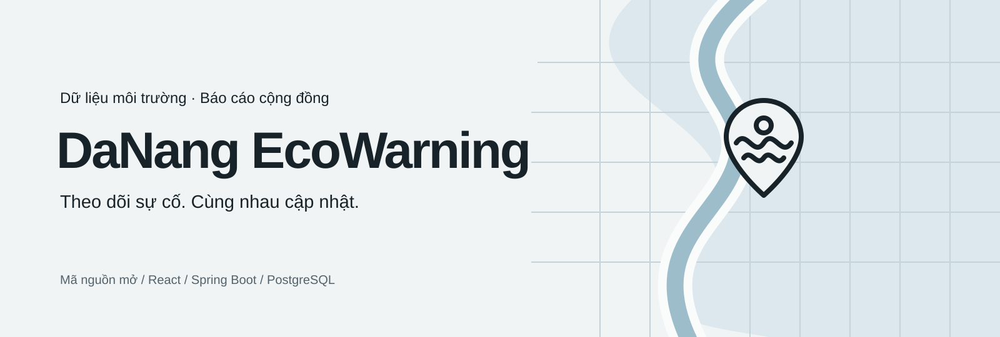

# DaNang EcoWarning



[](LICENSE)

Ứng dụng mã nguồn mở để tra cứu dữ liệu môi trường tại Đà Nẵng và theo dõi vòng đời báo cáo sự cố từ cộng đồng.

## Chức năng

- Bản đồ công khai với bộ lọc diễn biến, xác minh, thời điểm cập nhật và độ ngập ước tính; lớp dữ liệu tham khảo tách khỏi sự cố.
- Gửi báo cáo có vị trí, thời điểm, mô tả và ảnh tùy chọn; nén ảnh, lưu nháp trên thiết bị, dùng mã chống tạo trùng khi thử lại.
- Báo cáo của tôi, chi tiết sự cố, lịch sử xử lý và bổ sung thông tin cộng đồng.
- Quản lý xác minh, từ chối có lý do, cập nhật diễn biến và gộp báo cáo; kiểm tra quyền tại backend và chống ghi đè cập nhật đồng thời.
- Theo dõi khu vực và nhận thông báo trong ứng dụng khi sự cố được quản lý xác minh/cập nhật.
- Tra cứu chuỗi dữ liệu khí hậu, nông nghiệp và thiệt hại với danh mục đối tượng/chỉ số lấy từ backend.
- Nhập quan sát CSV có ánh xạ cột, xem trước, kiểm tra đơn vị/trùng dữ liệu, tải lỗi và lịch sử nhập.
- Thời tiết và chất lượng không khí từ OpenWeather; mỗi phần có trạng thái tải/lỗi riêng.
- Tài khoản, OTP email, hồ sơ, đổi/khôi phục mật khẩu và làm mới phiên.

**Xác minh thông tin và diễn biến là hai trạng thái riêng.** Đã xác minh không có nghĩa sự cố đã kết thúc. Báo cáo cộng đồng và dữ liệu lịch sử không tự trở thành cảnh báo chính thức hoặc dữ liệu thời gian thực.

## Chạy nhanh

Yêu cầu Docker Compose và Node.js 22.

```bash
node scripts/configure.mjs
```

Điền khóa bản đồ, thời tiết, SMTP và Cloudinary trong `backend/.env` để dùng các dịch vụ tương ứng. Các secret database/JWT local được tạo ngẫu nhiên; file `.env` không đưa lên Git.

Windows:

```powershell
.\scripts\start.ps1
```

Linux/macOS:

```bash
sh scripts/start.sh
```

Mở [ứng dụng local](http://localhost:4173). Xem bản đồ không cần đăng nhập; gửi báo cáo và theo dõi khu vực cần tài khoản. Đăng nhập cần SMTP hoạt động để nhận OTP.

Xem [hướng dẫn cấu hình, phát triển, quyền quản lý, sao lưu và kiểm thử](docs/RUNNING.md).

## Kiến trúc

| Thành phần | Công nghệ / trách nhiệm |
| --- | --- |
| Frontend | React 18, Vite, SCSS/CSS, GoongJS, Recharts; Nginx proxy cùng origin khi chạy Docker |
| Auth Service | Spring Boot, JWT có mục đích riêng, OTP email, Redis |
| Collector Data Service | Nhập CSV lịch sử và quy trình xem trước/xác nhận nhập quan sát |
| Search Service | API tra cứu và danh mục dữ liệu động |
| Citizen Report Service | Báo cáo, xác minh/diễn biến, lịch sử, khu vực theo dõi, thông báo; Flyway migration |
| Hạ tầng | PostgreSQL 16, Redis 7, Spring Cloud Config, Eureka, API Gateway, Docker Compose |

Collector và Search đang dùng chung database dữ liệu khí hậu. Auth và báo cáo dùng database riêng. Upload ảnh qua Cloudinary có timeout, thực hiện ngoài transaction ghi báo cáo; hiện chưa dùng hàng đợi xử lý nền.

## Kiểm tra

```bash
cd frontend/Danang_EcoWarning_FE
npm ci
npm run build
npx eslint src/workspace src/App.jsx
```

Khi backend local đã chạy, tại gốc repo:

```bash
node scripts/integration-test.mjs
```

Script tích hợp chuẩn bị dữ liệu tạm, kiểm tra API và dọn fixture; chỉ dùng trên local. Xem đầy đủ cách chạy Java tests và giới hạn trong [RUNNING.md](docs/RUNNING.md).

## Phạm vi và dữ liệu

- Giá trị/đơn vị dữ liệu lịch sử được giữ từ nguồn; không tự áp hệ số quy đổi khi chưa đối chiếu dữ liệu gốc.
- Ghi nhận cũ chưa có owner được giữ lại; không tự gán cho một tài khoản.
- Thông báo hiện trong ứng dụng; email/push thông báo sự cố chưa triển khai.
- Gợi ý báo cáo trùng có giới hạn tập dữ liệu; thống kê tái diễn là nhóm theo ô tọa độ, không thay cho khảo sát thực địa.
- Không triển khai AI, dự báo ngập hoặc chỉ đường an toàn trong bản nâng cấp này.
- Các khóa/địa chỉ bên ngoài cần cấu hình riêng. Không có số liệu tải hay độ chính xác dự báo được bịa để minh họa.

[Kế hoạch và đánh giá ban đầu](docs/PLAN.md) · [Trạng thái triển khai](IMPLEMENTATION.md) · [Hệ thống giao diện](DESIGN.md)

## Nguồn gốc và giấy phép

Dự án phát triển từ [DaNang EcoWarning của KhuongSpring](https://github.com/KhuongSpring/DaNang_EcoWarning), trong bối cảnh cuộc thi Phần mềm nguồn mở Olympic Tin học Sinh viên Việt Nam 2025, đội HaUI.HIT_NovaForge. Giữ ghi nhận đóng góp của các tác giả ban đầu: Phạm Minh Khương, Nguyễn Lê Hoài Nam, Đào Duy Chiến.

Phát hành theo GNU General Public License v3.0; xem [LICENSE](LICENSE). Logo và banner SVG mới lưu trong repo để hiển thị ổn định, không phụ thuộc ảnh bên ngoài.

### Thiết kế và kiểm chứng

Xem [báo cáo sử dụng taste-skill / impeccable](docs/SKILL-REVIEW.md), ảnh giao diện và kết quả kiểm tra. Font Be Vietnam Pro được tự host và có [giấy phép OFL](frontend/Danang_EcoWarning_FE/public/fonts/OFL-Be-Vietnam-Pro.txt).
